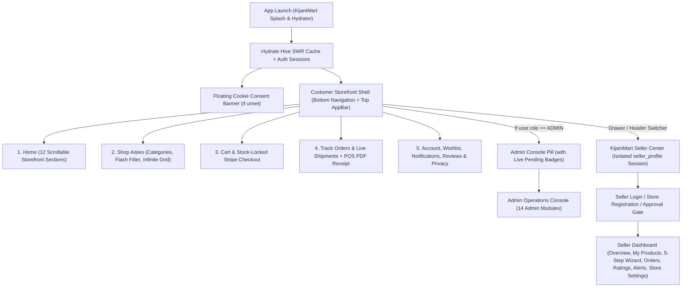

# KijaniMart Flutter Mobile App — Complete Implementation Plan (`mobile/`)

> [!IMPORTANT]
> This plan specifies a **100% feature-complete Flutter mobile application** in [mobile](file:///c:/Users/HomePC/Desktop/OnlineGroceryStore/mobile) connected directly to the existing Node.js/Express + MongoDB backend ([server/index.js](file:///c:/Users/HomePC/Desktop/OnlineGroceryStore/server/index.js)). It covers every Customer Storefront workflow, the full **Admin Console** (unlocked when `user.role == 'ADMIN'`), and the standalone **KijaniMart Seller Center** (with an isolated `seller_profile` authentication session).

---

## 1. System Architecture & Multi-Portal Navigation Flow



### 1.1 Tech Stack & Flutter Packages (`mobile/pubspec.yaml`)

| Layer | Package | Responsibility |
| :--- | :--- | :--- |
| **State & Caching** | `flutter_riverpod`, `riverpod_annotation` | Reactive state, deduplicated query caching (`staleTime: 2m`, `gcTime: 30m`), 0ms card-to-detail `placeholderData` seeding |
| **Networking & Auth** | `dio` | Request/response interceptors, proactive (20s skew) & reactive (`401 TOKEN_EXPIRED`) single-flight `/api/v1/refresh-token` rotation |
| **Secure & Local Storage** | `flutter_secure_storage`, `hive_flutter`, `shared_preferences` | Dual isolated token vaults (`profile` vs. `seller_profile`), user-scoped cart (`cart_<uid>`), persistent catalog cache (`freshmart_rq_cache_v1`), cookie consent (`freshmart_cookie_consent_v1`) |
| **Routing & Deep Links** | `go_router` | Declarative routing, `PrivateRoute` & `ADMIN` role guards, notification deep links (`/products/:id?review=true&order=...`), scroll-to-top on navigation |
| **UI, Icons & Charts** | `flutter_svg`, `google_fonts`, `fl_chart`, `cached_network_image`, `shimmer` | Custom `kijanimart-logo.svg` brand mark, Material Symbols icons, Admin & Seller revenue/category charts, smooth image caching |
| **Native Device Features** | `image_picker`, `file_picker`, `geolocator`, `url_launcher` | Avatar & 5-step product gallery camera/photo upload, Admin Bulk `.csv` picker, Pickup Station `"Use My Current GPS"` & Google Maps pin launcher |
| **POS PDF & Payments** | `printing`, `path_provider`, `open_filex`, `share_plus`, `webview_flutter` | Downloading, previewing, printing, and sharing the 80mm thermal POS PDF receipt (`GET /orders/:id/receipt.pdf`) and completing Stripe Checkout |

---

## 2. Folder Structure (`mobile/`)

```text
mobile/
├── pubspec.yaml
├── assets/
│   ├── icons/
│   │   └── kijanimart-logo.svg          # Emerald shopping basket + organic leaf + lightning bolt
│   └── images/
│       ├── delivery.png                 # Hero express rider illustration
│       ├── categories/                  # All, Fruits & Vegetables, Meat, Dairy, Breakfast, Beverages, Chocolate, Chips, Ice Cream
│       └── why/                         # Under 20 Minutes, Farm-Fresh Quality, Unbeatable Local Prices
└── lib/
    ├── main.dart                        # App bootstrap, Hive cache hydration, ProviderScope
    ├── app.dart                         # MaterialApp.router, KijaniMart emerald theme, global Cookie Consent overlay
    ├── core/
    │   ├── config/
    │   │   └── api_endpoints.dart       # Base URLs matching client/src/api/BaseURLs.js
    │   ├── network/
    │   │   ├── dio_client.dart          # Dio instance + X-Session-Id + dual-session auth interceptor
    │   │   └── auth_session_manager.dart# Isolated 'profile' vs 'seller_profile' JWT expiry & single-flight refresh
    │   ├── cache/
    │   │   └── swr_query_cache.dart     # 24h persistent snapshot hydration + 2-min staleTime + cookie performance guard
    │   ├── telemetry/
    │   │   └── interaction_tracker.dart # CLICK, VIEW, DWELL (>=2s), CART_ADD, WISHLIST_ADD, SEARCH + consent check
    │   └── utils/
    │       ├── flash_countdown.dart     # Shared 1s Stream ticker, getFlashSaleEndMs, getSoonestFlashSaleEndMs
    │       ├── pricing_utils.dart       # formatKES, getDiscountPercent, getEffectivePrice, getOriginalPrice
    │       └── order_status_meta.dart   # 12 canonical order/shipment statuses, colors, icons & labels
    ├── models/
    │   ├── user_model.dart              # User, Address, SellerProfile, Role, GDPR retention fields
    │   ├── product_model.dart           # Product, Nutrition, SellerInfo, Review, PendingChanges, FlashSaleEndsAt
    │   ├── order_model.dart             # Order, Shipment, StatusHistoryStep, PickupStation
    │   ├── notification_model.dart      # AppNotification, DeliveryReviewItem
    │   └── admin_models.dart            # AdminOverviewKpis, AuditLogEntry, TrashSummary
    ├── shared/
    │   ├── widgets/
    │   │   ├── kijani_app_bar.dart      # Brand lockup, Nairobi location pill, search bar, Admin pill, Bell, Wishlist, Cart
    │   │   ├── product_card.dart        # Badges (Sold Out, Flash -X%, -X% OFF, Only N left, Farm Fresh), heart, live timer strip, KES price, Add / - 1 + stepper
    │   │   ├── category_aisle_strip.dart# Horizontal scrollable 9 category cards (All + 8 aisles) with active flash filter retention
    │   │   ├── confirm_action_modal.dart# Reusable confirmation dialog with optional reason input
    │   │   ├── icon_action_button.dart  # Compact table/card icon buttons with native Tooltip labels
    │   │   ├── table_pagination_bar.dart# Rows-per-page selector (5/10/20/50) + page jumper
    │   │   └── cookie_consent_sheet.dart# Floating bottom-left style cookie card linking to /privacy
    └── features/
        ├── auth/                        # Login, Signup, Forgot Password, Reset Password
        ├── home/                        # 12-Section scrollable Homepage
        ├── products/                    # Products catalog (infinite scroll + flash banner timer) & Product Details screen
        ├── cart_checkout/               # User-scoped Cart, Doorstep vs Pickup Hub Checkout, Stock Lock, Stripe WebView, Success
        ├── orders_shipping/             # Track Orders & Shipments Hub, 6-char ID lookup, 6-step timeline, POS PDF Receipt viewer
        ├── wishlist/                    # User-scoped self-healing Wishlist screen
        ├── profile/                     # Profile & Address, Pending Reviews tab, Password & 365-Day GDPR Self-Suspend tab
        ├── notifications/               # Notifications screen (All/Mine admin toggle) + auto-popup DeliveryReviewModal
        ├── privacy/                     # Privacy & Cookie Notice screen with live preference toggles & cookie inventory table
        ├── admin/                       # Full 14-Module Admin Console with live sidebar/drawer pending badges
        └── seller/                      # Full 7-Tab KijaniMart Seller Center with isolated seller_profile session
```

---

## 3. Core Cross-Cutting Mechanisms (Zero Compromises)

### 3.1 Dual Isolated Authentication (`profile` vs. `seller_profile`) & Token Expiry
Mirrors [authSession.js](file:///c:/Users/HomePC/Desktop/OnlineGroceryStore/client/src/utils/authSession.js) and [api/index.js](file:///c:/Users/HomePC/Desktop/OnlineGroceryStore/client/src/api/index.js):
- **Two Separate Secure Sessions**:
  - **Customer & Admin Session (`profile`)**: Used across all Storefront and Admin Console screens.
  - **Seller Center Session (`seller_profile`)**: Used exclusively inside the Seller Center portal mode. Signing in as a Seller in Seller Center **never** overwrites or logs out the Customer or Admin account in the main app.
- **JWT Expiry & Rotation**:
  - Decodes JWT `exp` claims (`decodeJwtExpMs`) and tracks `accessToken` (`15m`), `refreshToken` (`7d`), `accessTokenExpiresAt`, and `refreshTokenExpiresAt`.
  - **Proactive Refresh**: Rotates the access token automatically 45 seconds before expiry via a background timer, or inside the Dio request interceptor if expiring within 20 seconds.
  - **Single-Flight Reactive Refresh**: When any protected call returns `401` with `code: "TOKEN_EXPIRED"`, queues concurrent requests behind a single `POST /api/v1/refresh-token` call and transparently retries them.
  - **Revocation & Hard Expiry**: Calls `POST /api/v1/logout` on sign-out to revoke the hashed refresh token in MongoDB, and automatically signs out if `refreshTokenExpiresAt` is reached.

### 3.2 Persistent SWR Caching & 0ms Product Details Preview
Mirrors [queryCachePersist.js](file:///c:/Users/HomePC/Desktop/OnlineGroceryStore/client/src/utils/queryCachePersist.js) and [ProductDetails.js](file:///c:/Users/HomePC/Desktop/OnlineGroceryStore/client/src/pages/product-details/ProductDetails.js):
- Persists catalog query snapshots (`recommendations`, `flashSales`, `homeNewestProducts`, `homePickupStations`, `products`) in Hive for up to 24 hours.
- Hydrates cached snapshots before the first frame so the app opens in **0ms with real products** while silently revalidating stale data (`staleTime: 2 minutes`, `gcTime: 30 minutes`).
- Tapping any `ProductCard` immediately seeds `ProductDetailsScreen` from the in-memory card object (image, name, category, weight, price, discount, rating, seller, stock) with **zero loading spinner** while full reviews and related products load in the background.

### 3.3 Shared 1-Second Flash Countdown Engine
Mirrors [flashCountdown.js](file:///c:/Users/HomePC/Desktop/OnlineGroceryStore/client/src/utils/flashCountdown.js):
- A single shared 1-second `Stream<int>` clock provider updates all visible flash-sale timers simultaneously without spawning multiple timers.
- `getFlashSaleEndMs(product, nowMs)` reads each product's own `flash_sale_ends_at` date (falling back to local midnight if unset/past).
- `getSoonestFlashSaleEndMs(products, nowMs)` computes the true earliest end timestamp across displayed flash-sale products so the Homepage header timer and `/products?flash=true` banner timer always match the soonest-ending product card to the exact second (including `Xd : HHh : MMm : SSs` multi-day support).

---

## 4. Complete Feature-by-Feature Specification

### Module 1: Top Header Bar, Navigation Shell & Floating Cookie Popup
- **Announcement Strip**: `"⚡ 20-Min Express Delivery • 100% Farm-Fresh Groceries • Free delivery on orders above 2,000 KES"` + quick links to `Track Order`, `Track Shipping`, and `Seller Portal ↗`.
- **Main Header (`KijaniAppBar`)**:
  - Custom **KijaniMart** SVG logo badge + `"Deliver to Nairobi, KE"` location pill.
  - Search bar (`"Search kale, milk, fruits, chicken, snacks..."`) recording `SEARCH` telemetry on submit and routing to `/products?search=...`.
  - **Role-Aware Admin Pill**: Visible when `user.role == 'ADMIN'`, opening the Admin Console with live pending counter badges.
  - **Notification Bell**: Live unread badge (`unreadCount`), tapping opens the Notifications dropdown/sheet with instant 0ms `All (N)` vs `Mine (N)` toggle for Admins, `Mark all read`, and deep-link navigation.
  - **Wishlist Heart Icon**: Displays live sanitized `user.wishlist.length` badge.
  - **Cart Pill**: Green pill showing live total unit count (`Cart N`).
  - **Account Menu**: Shows user avatar photo (or initial), name, email, links to `My Profile`, `Wishlist (N)`, `Track Orders`, `Notifications (N)`, `Pending Reviews (N)`, `Seller Portal ↗`, `Admin Dashboard` (if Admin), and `Sign Out`.
- **Floating Cookie Consent Popup** (matching screenshot 1 & [CookieConsentPopup.js](file:///c:/Users/HomePC/Desktop/OnlineGroceryStore/client/src/components/cookie-consent/CookieConsentPopup.js)):
  - Appears at the bottom of the screen when `freshmart_cookie_consent_v1` is unset:
    - Title: **"This website uses cookies"**
    - Text: *"This website uses cookies. For further information on how we use cookies you can read our **Privacy and Cookie notice**"* (tapping opens `/privacy`).
    - Orange **"Accept cookies"** button on the bottom-right.

---

### Module 2: 12-Section Scrollable Homepage (`HomeScreen`)
Mirrors [Home.js](file:///c:/Users/HomePC/Desktop/OnlineGroceryStore/client/src/pages/home/Home.js) and Screenshot 1 (renders immediately on frame 1 without full-page blocking):
1. **Hero Banner**: `"FARM-TO-DOORSTEP IN 20 MINUTES"` pulse pill, *"Fresh Organic Groceries Delivered Fast."* title, `Explore Fresh Aisles →` and `Track Order` CTAs, `50+ Curated Products | Up to 25% Flash Discounts | 100% Freshness Guarantee` metrics, and interactive draggable Express Rider illustration with floating `"🥬 100% Farm Fresh"` and `"⚡ 20-Min Dispatch"` cards.
2. **Shop by Category Strip**: 9 category cards (`All`, `Fruits and Vegetables`, `Meat Poultry and Seafood`, `Dairy and Eggs`, `Breakfast`, `Beverages`, `Chocolate and Candy`, `Chips and Crackers`, `Ice Cream`) with subtitles and icons.
3. **Fresh New Arrivals Shelf (`✨ JUST ARRIVED TODAY`)**: Top 4 newest products sorted newest-first (`created_at: -1`), linking to `/products`.
4. **Today's Flash Sales & Discounts Shelf (`⚡ LIMITED-TIME FLASH DEALS`)**:
   - Header countdown box (`ENDS IN [Xd :] HHh : MMm : SSs`) synced to `getSoonestFlashSaleEndMs(displayedFlashSales)`.
   - `Shop All Deals >` button routing directly to `/products?flash=true`.
   - Horizontal/grid `ProductCard`s each displaying their own live per-product countdown strip (`⏱ Ends in 05:04:19`).
5. **Dual Editorial Spotlight Banners**:
   - **Emerald Card**: *"🌿 DIRECT FROM KENYAN HIGHLANDS — Certified Organic Greens & Daily Harvest"* + `100% Organic` badge + `Shop Fruits & Vegetables →`.
   - **Dark Slate Card**: *"🏪 KIJANIMART SELLER MARKETPLACE — Grow Your Farm or Grocery Business Online"* + `Open Seller Portal ↗`.
6. **Personalized / Recommended Fresh Picks**:
   - Dynamic eyebrow (`PERSONALIZED FOR <FIRST_NAME>` or `HANDPICKED FOR YOU`).
   - Renders `"Picked Just For You"` (with `✨ recommendation_reason` pills on each card such as *"Saved in your wishlist"*, *"Buy again"*, *"Recently viewed"*, *"Matches your recent search"*, *"Because you like..."*) plus top 2 affinity category shelves.
7. **How KijaniMart Works (4-Step Express Journey)**: `01 Pick Fresh Aisles` → `02 Instant Checkout & Stock Lock` → `03 Quality-Checked & Packed` → `04 20-Min Delivery & POS Receipt`.
8. **Doorstep Delivery & Free Pickup Hubs**:
   - Left highlight card: `⚡ 20-MIN EXPRESS — Direct Doorstep Rider Dispatch` with perks & `Start an Express Order →`.
   - Right grid: 4 active Nairobi Pickup Stations (`Westlands`, `Kilimani`, `CBD`, `Karen`) with `FREE PICKUP` tags, landmarks, and opening hours.
9. **Verified Customer Reviews & Trust Metrics**: `4.9 ★ Verified Rating | 20 min Avg Dispatch | 100% Verified Buyers` + 3 Nairobi shopper testimonial cards (`Wanjiku M.`, `Brian O.`, `Amina H.`).
10. **Why Choose KijaniMart**: 3 feature cards (`Under 20 Minutes`, `Farm-Fresh Quality`, `Unbeatable Local Prices`).
11. **Interactive FAQ Accordion**: 6 expandable Q&A items covering 20-min delivery, Pickup Stations, POS PDF receipts, freshness guarantee, selling on KijaniMart, and real-time checkout stock locking.
12. **Bottom Conversion Banner**: *"⚡ READY TO SHOP FRESH? Fill Your Basket with Farm-Fresh Groceries Today"* with `Start Shopping Now` and `Become a Seller` buttons.

---

### Module 3: Products Catalog, Flash Sale Filter & Product Cards (`ProductsScreen`)
Mirrors [Products.js](file:///c:/Users/HomePC/Desktop/OnlineGroceryStore/client/src/pages/products/Products.js), [ProductCard.js](file:///c:/Users/HomePC/Desktop/OnlineGroceryStore/client/src/components/product-card/ProductCard.js), and Screenshots 2 & 10:
- **Dynamic Header**: Shows `"Products"`, category name, `"Search: '...'"`, or `"⚡ Flash Sales & Discounts"` (and `"⚡ Flash Sales — <Category>"` when both category and flash filter are active).
- **Category Aisle Strip**: Tapping a category preserves `?flash=true` when the Flash Sales filter is active.
- **Flash Sales Filter Strip**:
  - When inactive: `"⚡ Filter Flash Sales & Discounts Only"` pill button.
  - When active (`?flash=true`, Screenshot 10): Amber banner showing `"⚡ Showing Flash Sales & Discounted Products"`, dark pill `"NEXT DEAL ENDS IN 05h : 04m : 19s"`, and `"Show All Products ✕"` reset button.
- **Infinite Scroll Product Grid**:
  - Uses pagination (`page=1, 2, ...`, 12 items per page, newest-first `{ created_at: -1, _id: -1 }`) with an automatic scroll listener and `"✓ Showing all N products"` end badge.
- **`ProductCard` Component**:
  - Top-left status badge: `Sold Out`, `⚡ Flash -X%`, `-X% OFF`, `Only N left` (when `stock <= 10`), or `🌿 Farm Fresh`.
  - Top-right Wishlist Heart button (prompts sign-in if guest; toggles `PATCH /api/v1/wishlist` and syncs Redux/Riverpod wishlist state).
  - Category tag + weight/measurement pill (`500 g`, `1 L`, `250 g`).
  - Product name, star rating chip (`★ 4.8`), and Seller store name (`HighLand Fresh Produce`, `Limuru Highlands Organic Farm`, etc.).
  - **Individual Live Flash Timer Strip** (`⏱ Ends in 05:04:19` or `2d 05:04:19`) driven by `product.flash_sale_ends_at`.
  - Strikethrough original price (`KES 120.00`) + effective price (`KES 117.60`).
  - `Add` button with fly-to-cart feedback, transforming into an inline `- 1 +` quantity stepper when the item is in the user's cart (capped at live `product.stock`).

---

### Module 4: Product Details, Nutrition Grid & Verified Reviews (`ProductDetailsScreen`)
Mirrors [ProductDetails.js](file:///c:/Users/HomePC/Desktop/OnlineGroceryStore/client/src/pages/product-details/ProductDetails.js) and Screenshots 3 & 4:
- **0ms Instant Preview**: Renders immediately from cached card data while fetching `GET /products/:id` and `GET /products/:id/review-eligibility`.
- **Active Dwell Time & View Telemetry**: Records `VIEW` on open and tracks active visible foreground time (`WidgetsBindingObserver`), flushing a `DWELL` event (`dwell_ms >= 2000`) when leaving the screen.
- **Multi-Image Gallery Slider & Thumbnail Strip**: Left/right arrows, swipe gesture, slide counter (`1 / 3`), discount/flash badge overlay, and tappable thumbnail strip.
- **Product Spec & Provenance Panel** (Screenshot 4):
  - Brand & SKU header (`CRISPYKETTLE SNACKS • SKU FM-CH-046`), title, star rating + review count, weight, and live stock status (`In stock (55)` / `Only N left` / `Out of stock`).
  - Effective price in KES, strikethrough old price, and `"You save KES X.XX (Y%)"` badge.
  - Full-width dark `"Add to Cart — KES 230.00"` button (or quantity stepper) + Wishlist heart button.
  - **4-Row Provenance Table**:
    - `Seller`: Store name, location, verified badge & seller rating (`CrunchTime Snack Co. (Industrial Area, Nairobi) • ★ 4.8`)
    - `Origin`: Farm/region origin (`Nakuru & Nairobi, Kenya`)
    - `Packed / Harvested`: Formatted harvest/packing date (`23 Nov 2026`)
    - `Shelf Life & Storage`: Shelf life & storage instructions (`6 Months • Reseal bag tightly...`)
- **6-Card Nutritional Information Grid** (Screenshot 3):
  - `Calories` (`485 kcal / 100g`), `Protein` (`6.8g`), `Carbohydrates` (`58.0g`), `Total Fat` (`24.0g`), `Dietary Fiber` (`4.5g`), and `Micronutrients` (`Potassium, Vitamin E`).
- **Customer Reviews & Verified Buyer Review Form** (Screenshot 3):
  - Overall rating (`4.9 ★ Based on 2 verified deliveries`) + 5-star to 1-star horizontal distribution progress bars.
  - **"Verified Deliveries Only"** eligibility card:
    - Checks `GET /products/:id/review-eligibility`.
    - Only buyers with a `DELIVERED` / `FULFILLED` order containing this product can submit or edit their review.
    - Dual 5-star selectors (**Product Rating 1–5★** and **Seller Rating 1–5★**) + written review comment (`POST /products/:id/reviews`).
  - Chronological review list with buyer name, `Verified Delivery` badge, date, product stars, `Seller rating: 5/5`, and comment.
- **Related / You May Also Like Shelf**: 4 personalized related products (`product.related_products`).

---

### Module 5: User-Scoped Cart, Stock-Locked Checkout & Stripe Payment
Mirrors [Cart.js](file:///c:/Users/HomePC/Desktop/OnlineGroceryStore/client/src/pages/cart/Cart.js), [checkout.js](file:///c:/Users/HomePC/Desktop/OnlineGroceryStore/client/src/pages/checkout/checkout.js), [OrderSummary.js](file:///c:/Users/HomePC/Desktop/OnlineGroceryStore/client/src/components/order-summary/OrderSummary.js), [success.js](file:///c:/Users/HomePC/Desktop/OnlineGroceryStore/client/src/pages/checkout/success.js), and Screenshots 7 & 8:
- **User-Scoped Cart Persistence**:
  - Stored locally under `cart_<user._id>` and synced with MongoDB via `GET /api/v1/cart` and `PUT /api/v1/cart` so carts never leak between different accounts on the same phone.
- **Shopping Cart Screen** (Screenshots 7 & 8):
  - Empty state with `"Your shopping cart is empty"` and `"Start Shopping"` CTA.
  - Populated state: Item cards with thumbnail, category, title, weight pill, `- 1 +` stepper, line total (`230.00 KES`), and unit breakdown (`230.00 KES / 175g`), plus an **Order Summary** card (`Original Price`, `Flash/Discount Savings`, `Express 20-Min Delivery: FREE`, `Payable Total`, and `Proceed to Checkout →`).
- **Checkout Screen (`/checkout`)**:
  - **Real-Time Stock Verification & Checkout Token (`jti`)**: Calls `POST /products/cart` and `POST /products/stock-check` (excluding the user's own `checkout_token_id` hold) to reserve stock and prevent overselling.
  - **Fulfillment Method Toggle**:
    1. **20-Min Express Doorstep Delivery**: Pre-fills user contact details and Nairobi delivery address (`City`, `Area / Estate`, `Street`, `Building`, `Floor`, `Apartment`).
    2. **FREE Pickup Station Collection**: Lists active KijaniMart Pickup Hubs (`GET /shipping/pickup-stations`) with area, landmark, opening hours, contact phone, and `"Open in Google Maps ↗"` link.
  - **Stripe Checkout Integration**: Calls `POST /payments` to create a Stripe Checkout Session and opens the hosted Stripe payment flow; on cancel or back-navigation, calls `DELETE /payments/pending/:orderId` to release the temporary stock hold immediately.
  - **Checkout Success Screen (`/checkout/success`)**: Verifies `GET /payments/session/:sessionId`, clears the user's cart, displays the confirmed 6-character Order ID, and provides buttons to **Track Live Shipment** or **Download POS Receipt (PDF)**.

---

### Module 6: Track Orders & Shipments Hub + 80mm Thermal POS PDF Receipt
Mirrors [Shipment.js](file:///c:/Users/HomePC/Desktop/OnlineGroceryStore/client/src/pages/shipment/Shipment.js), [OrderId.js](file:///c:/Users/HomePC/Desktop/OnlineGroceryStore/client/src/pages/order/id/OrderId.js), [ShipmentId.js](file:///c:/Users/HomePC/Desktop/OnlineGroceryStore/client/src/pages/shipment/id/ShipmentId.js), and Screenshot 5:
- **Live Delivery & Shipment Hub Header** (Screenshot 5):
  - Green banner with `"Enter 6-character Order ID (e.g. 1CGMKP)"` search input + `"Track Shipment →"` button.
  - 3 KPI Summary Cards: `TOTAL ORDERS`, `ACTIVE / IN TRANSIT`, `COMPLETED DELIVERIES`.
  - **13 Status Filter Chips**: `All (N)`, `Order Placed`, `Pending Confirmation`, `Waiting to be Shipped (N)`, `Shipped`, `Available for Pickup`, `Delivered (N)`, `Return in Progress`, `Returned`, `Refunded`, `Failed Delivery`, `Cancelled`, `Cancelled (Payment Unsuccessful)`.
- **Order & Shipment Cards**:
  - `#OrderID` badge, timestamp, `Doorstep Delivery` vs `Pickup Station` pill, status badge, total in KES.
  - **6-Step Horizontal Progress Stepper**: `1 Order Placed` → `2 Pending Confirmation` → `3 Waiting to be Shipped` → `4 Shipped` → `5 Available for Pickup` → `6 Delivered`.
  - Item thumbnail strip + Delivery Address / Pickup Hub card.
- **Order Receipt & Live Shipment Details Screen (`/orders/:id` & `/shipping/:id`)**:
  - Animated progress bar with rider/cart indicator.
  - Chronological **Order & Shipment Status History** timeline with dates & notes.
  - Itemized receipt breakdown (quantities, unit prices, discounts, total paid).
  - **"Download POS Receipt (PDF)" Button**: Fetches `GET /orders/:id/receipt.pdf` (the 80mm thermal POS receipt with barcode, VAT breakdown, and itemized lines) and opens the native PDF preview/print/share sheet.
  - When status is `DELIVERED`, displays quick `"Rate Your Produce & Seller ★"` buttons for each item.

---

### Module 7: User-Scoped Self-Healing Wishlist (`WishlistScreen`)
Mirrors [Wishlist.js](file:///c:/Users/HomePC/Desktop/OnlineGroceryStore/client/src/pages/wishlist/Wishlist.js) and Screenshot 6:
- Queries `GET /api/v1/wishlist` under the user-scoped key `['wishlist', userId]`.
- Automatically syncs valid returned product IDs back to the local user profile state so stale/deleted product IDs are pruned and the header heart badge count (`My Wishlist (4)`) is always 100% accurate.
- Displays a 2-column responsive `ProductCard` grid with instant Add-to-Cart and heart un-wishlist support, or the `"No saved favorites yet"` empty state.

---

### Module 8: Customer Profile, Pending Reviews & 365-Day GDPR Self-Suspension
Mirrors [Profile.js](file:///c:/Users/HomePC/Desktop/OnlineGroceryStore/client/src/components/profile/Profile.js) and Screenshot 9:
- **Profile Header Card**:
  - Avatar photo with `Upload Photo` (camera/gallery picker + client-side 320×320 JPEG crop/resize) and `Remove` buttons.
  - Role badge (`Store Administrator` / `Verified Seller` / `Customer`), default address pill, email, phone, and quick action buttons (`Admin Console`, `Track Orders`, `Sign Out`).
- **5 Account KPI Cards**: `ORDERS PLACED`, `LIFETIME SPEND (KES)`, `SAVED WISHLIST`, `ACTIVE BASKET`, `PENDING REVIEWS`.
- **3 Sub-Tabs**:
  1. **`Edit Profile & Address`**: Upload file or paste image URL, First Name, Last Name, Email (read-only), Phone, Bio, and Default Nairobi Delivery Address (`City`, `Area`, `Street`, `Building`, `Floor`, `Apartment`) via `PATCH /api/v1/profile`.
  2. **`Pending Reviews`**: Lists unreviewed items from delivered orders (`GET /products/pending-reviews`) with inline 5-star Product + Seller rating modal, plus the user's submitted review history.
  3. **`Security & Password`**:
     - **Change Password**: Current password + new password (min 8 chars), calling `PATCH /api/v1/profile/password` and rotating the active JWT token pair.
     - **Self-Suspend Account (365-Day GDPR Trash)**: Password-confirmed account suspension (`POST /api/v1/profile/suspend`) moving the account into 365-day GDPR archival retention (with sole-admin lockout protection) and signing out cleanly.
- **Recent Orders Section**: Quick list of the user's latest 6 orders with one-tap `Receipt` and `Track →` links.

---

### Module 9: Notifications Center & Auto-Popup Delivery Review Modal
Mirrors [NotificationsPage.js](file:///c:/Users/HomePC/Desktop/OnlineGroceryStore/client/src/pages/notifications/NotificationsPage.js), [DeliveryReviewModal.js](file:///c:/Users/HomePC/Desktop/OnlineGroceryStore/client/src/components/review-modal/DeliveryReviewModal.js), and Screenshot 13:
- **Full Notifications Screen (`/notifications`)**:
  - **Admin Scope Toggle** (Screenshot 13): `All Notifications (N)` vs `Mine Only (N)` with instant 0ms client-side filtering and third-person actor formatting (`"👤 Meshack placed Order #..."`, `"HighLand Fresh Produce reported Order #1CGMKP as WAITING TO BE SHIPPED"`).
  - Search bar (`"Search by user name, email, Order ID, or notification message..."`), status pills (`All`, `Unread`, `Read`), and notification type dropdown filter.
  - Action chips on each notification (`Open Order #1CGMKP →`, `Review Product Edits →`, `Review & Apply to Order →`, `Restock in Inventory →`, `★ Rate Products & Seller`, `✓ Mark read`).
- **Auto-Popup `DeliveryReviewModal`**:
  - Automatically pops up when a `DELIVERY_REVIEW` notification has `dismissed_popup == false`, allowing the customer to rate each delivered product and its seller right from the modal.

---

### Module 10: Cookie Consent & Privacy Notice Center (`PrivacyNoticeScreen`)
Mirrors [PrivacyNotice.js](file:///c:/Users/HomePC/Desktop/OnlineGroceryStore/client/src/pages/privacy/PrivacyNotice.js):
- **Live Cookie & Storage Preference Center**:
  - Status pill (`✓ Cookies Accepted`, `🔒 Essential Cookies Only`, or `⏳ Awaiting Consent Choice`).
  - Toggle switches for:
    1. *Strictly Necessary & Authentication Cookies* (`Always Active`)
    2. *Personalization & Smart Recommendations* (controls `interaction_tracker.dart`)
    3. *Performance & Instant Catalog Caching* (controls `swr_query_cache.dart`)
  - Action buttons: `Accept All Cookies`, `Save My Preferences`, `Essential Cookies Only`, and `Re-open Cookie Popup`.
- **Cookie & Storage Inventory Cards/Table**: Details `freshmart_cookie_consent`, `profile` (15m Access / 7d Refresh JWTs), `cart_<userId>`, `freshmart_session_id`, and `freshmart_rq_cache_v1`.
- **Kenya Data Protection Act (2019) & GDPR Retention Policy**: Details the 365-day GDPR account archival window and 30-day product trash window.

---

### Module 11: Role-Gated Admin Console (`user.role == 'ADMIN'`)
Mirrors [AdminLayout.js](file:///c:/Users/HomePC/Desktop/OnlineGroceryStore/client/src/components/admin-layout/AdminLayout.js), [Admin.js](file:///c:/Users/HomePC/Desktop/OnlineGroceryStore/client/src/pages/admin/default/Admin.js), and Screenshots 11–21:

#### Admin Navigation Drawer & Top Bar with Live Pending Counter Badges
Displays live orange/red/blue counter pills matching Screenshot 11:
- `Analytics Dashboard`
- `Audit & Activity Logs`
- `All Notifications` *(badge: unread count)*
- `All Orders` *(badge: active/seller-update orders)*
- `Update Order Status`
- `All Shipments` *(badge: active shipments)*
- `Update Shipping Status` *(badge: active shipments)*
- `Pickup Stations`
- `Inventory Manager` *(badge: low/out-of-stock + pending product approvals/edits)*
- `Add New Product`
- `Bulk CSV Update`
- `Manage Sellers` *(badge: pending seller applications)*
- `User Management`
- `Trash & GDPR` *(badge: trashed products + suspended users)*

#### All 14 Admin Screens & Modals:
1. **Executive Analytics & Operations Dashboard** (Screenshot 11):
   - **Automated Low-Stock Monitor Banner**: Shows 5-minute check status, 6-hour email reminder cooldown status, last check timestamp, and `"Run Stock Scan Now"` button (`POST /admin/stock-alerts/run`).
   - **Action Alert Banners**: Low Stock Alert banner (`View Low Stock →`) and Marketplace Seller Action Needed banner (`Review Product Edits (N) →` / `Review Seller Requests →`).
   - **6 KPI Cards**: `TOTAL STORE REVENUE`, `TOTAL ORDERS`, `EXPRESS DISPATCHES`, `CATALOG & STOCK VALUE`, `REGISTERED ACCOUNTS`, `PROMOS & STOCK ALERTS`.
   - **Analytics Charts (`fl_chart`)**: Revenue trend area chart, Order Status breakdown bar chart, Category stock/revenue distribution, Top-Selling Products list, and Recent Activity feed.
2. **System Audit & Activity Logs** (Screenshot 12):
   - Category filter (`All Categories`, `ORDERS`, `SHIPPING`, `INVENTORY`, `SELLERS`, `USERS`, `TRASH`, `SYSTEM`) and Severity filter (`All Severities`, `INFO`, `WARNING`, `CRITICAL`).
   - Chronological audit cards + **"Record Operational Log Entry"** form (`POST /admin/logs`).
3. **All Customer Orders** (Screenshot 14) & **Admin View Order (`/admin/orders/:id`)**:
   - 4 KPI cards (`TOTAL ORDERS`, `ACTIVE REVENUE`, `ACTIVE / IN PROGRESS`, `DELIVERED`).
   - Search bar + 14 status filter chips including **`🏪 Seller Updates (N)`**.
   - Paginated orders list with inline **Quick Update** status dropdown (`PATCH /orders/:id`), seller proposed status review banner (`Apply Seller Update`), full order inspection view, and **`Download POS Receipt (PDF)`**.
4. **Update Order Status Lookup Tool** (Screenshot 15):
   - 6-character Order ID lookup input + **Quick-Select Recent Orders** tappable list.
5. **All Shipments & Express Dispatches** (Screenshot 16):
   - 4 KPI cards (`TOTAL SHIPMENTS`, `WAITING / QUEUED`, `SHIPPED / PICKUP READY`, `DELIVERED`), search bar, status filter chips, `Doorstep` vs `Pickup` badges, destination / Pickup Hub details, inline **Quick Update** status dropdown (`PATCH /shipping/:id`), and links to `Tracker` & `Order`.
6. **Update Shipping & Dispatch Status Lookup Tool** (Screenshot 17):
   - 6-character Shipment Order ID lookup + **Quick-Select Recent Shipments** list.
7. **Manage Pickup Stations** (Screenshot 18):
   - **"Use My Current GPS"** button (`geolocator`) + Google Maps location search & coordinate pin.
   - Form for Pickup Station Name, City, Area/Estate, Street/Building Address, Landmark, Contact Phone, Opening Hours, Latitude/Longitude, and Active toggle (`POST /shipping/pickup-stations`).
   - Configured Pickup Stations list with GPS coordinates badge, `"Open in Google Maps ↗"`, `Edit Station`, and `Delete`.
8. **Live Product & Inventory Manager** (Screenshot 19):
   - Search bar, Category dropdown, and Stock/Status filter (`All Products`, `Low Stock <= 10`, `Out of Stock`, `Flash Deals`, `Pending Seller Approval`, `Pending Seller Edits`).
   - Product row with thumbnail, SKU, weight, seller store badge, publishing status (`✓ Published`, `⏳ Pending Approval`, `🚫 Rejected`), and **`✏️ Seller Edits Pending`** side-by-side field diff card (`Name: Test Seller → Test Seller 1`).
   - **7 Compact Icon Action Buttons with Tooltips**:
     1. `Approve Changes ✓` (`PATCH /admin/products/:id/pending-changes` or `/approval`)
     2. `Reject Changes` (opens reason modal)
     3. `Publish / Unpublish`
     4. `View Product Details Modal` (`AdminProductViewModal` showing gallery, pricing, farm provenance, nutrition, seller info, and quick jump to Full Edit)
     5. `Full Edit (5-Step Wizard)`
     6. `Quick Edit` (inline price, discount %, stock, and flash sale toggle)
     7. `Move to 30-Day Trash` (`ConfirmActionModal` with optional reason → `DELETE /admin/products/:id`)
9. **Add / Full Edit Product — 5-Step Wizard** (Screenshot 20):
   - Responsive 5-step horizontal stepper (`1 Basic Details` → `2 Media Gallery` → `3 Pricing & Stock` → `4 Farm & Storage` → `5 Nutrition & Review`).
   - Supports both creating new products (`POST /products`) and full editing existing products (`PUT /admin/products/:id/full`) with multi-image uploads (cover + up to 6 gallery images via camera/gallery or URL), flash sale end-date picker, seller assignment, and live preview card.
10. **Bulk CSV Inventory Update** (Screenshot 21):
    - `Download Sample CSV` button, `.csv` file picker (`file_picker`), required 8-column validator (`product_id,name,price,image,weight,measurement,category,stock`), and mode selector: **Update Products by ID (Recommended)** vs **Replace Entire Catalog** (`PATCH /products`).
11. **Marketplace Sellers & Approval Requests** (Screenshot 22):
    - 4 KPI cards (`TOTAL REGISTERED SELLERS`, `PENDING ADMIN APPROVAL`, `APPROVED ACTIVE STORES`, `COMBINED SELLER EARNINGS`).
    - Search by store name/owner/email/location + status filter (`All Statuses`, `PENDING`, `APPROVED`, `REJECTED`, `SUSPENDED`).
    - Seller cards/rows with store metadata, product counts, units sold, gross earnings, ratings, and icon action buttons with tooltips (`Approve Store`, `Reject Store` with reason, `Suspend Store`, `Reactivate Store` via `PATCH /admin/sellers/:id/status`).
12. **User & Role Management** (Screenshot 23):
    - Search users by name/email + Role filter (`All Roles`, `ADMIN`, `SELLER`, `USER`).
    - Displays user avatar, name, email, role badge, orders count, lifetime spend in KES, active cart count, and saved wishlist count.
    - Icon action buttons with tooltips to change role (`Promote to Admin`, `Set as Seller`, `Set as Customer` via `PATCH /admin/users/:id/role`) and **`Suspend User to GDPR Trash`** (`DELETE /admin/users/:id` with reason modal and sole-admin self-lockout protection).
13. **Trash Bin & GDPR Data Retention** (Screenshot 24):
    - Automated Retention Cleanup status banner (`Products: 30d auto-delete • Users (GDPR): 365d statutory hold`) + **`Run Cleanup Sweep Now`** button (`POST /admin/trash/purge-now`).
    - 2 Summary Cards & Sub-Tabs:
      - **`Trashed Products (N) — 30-Day Retention`**: Search trashed products, view deleted date, deleted-by actor, deletion reason, days-remaining badge, **`Restore Product`** (`PATCH /admin/trash/products/:id/restore`), and **`Permanent Delete`** (`DELETE /admin/trash/products/:id/permanent`).
      - **`Suspended Users • GDPR (N) — 365-Day Retention`**: Search suspended accounts, view suspension reason, `deleted_by` (`ADMIN` vs `SELF`), GDPR retain-until date & countdown badge, **`Restore Account`** (`PATCH /admin/trash/users/:id/restore`), and **`Permanent Erase`** (`DELETE /admin/trash/users/:id/permanent`).

---

### Module 12: KijaniMart Seller Center (Standalone Portal Mode with Isolated `seller_profile` Session)
Mirrors [SellerPortal.js](file:///c:/Users/HomePC/Desktop/OnlineGroceryStore/client/src/pages/seller/SellerPortal.js), [SellerProductWizard.js](file:///c:/Users/HomePC/Desktop/OnlineGroceryStore/client/src/pages/seller/SellerProductWizard.js), and Screenshot 25:
- **Isolated Seller Session (`seller_profile`)**:
  - Accessible from the main app drawer/header (`"Seller Portal"`).
  - Uses `readStoredSellerProfile()` / `writeStoredSellerProfile()` so a user can sign into a Seller account in Seller Center while staying signed into a completely different Customer or Admin account in the main Storefront!
  - Includes a top bar with Seller store name, `Verified Partner` badge, Seller Notification Bell, Seller profile chip, **`Customer Storefront`** button (switches back to the customer storefront shell), and **`Sign Out`** (signs out of `seller_profile` only).
- **Seller Auth & Onboarding Gateway**:
  - **Sign In Tab** (`POST /api/v1/login` stored to `seller_profile`) & **Register Seller Store Tab** (`POST /seller/register` with store name, location, category focus, description).
  - If signed into a regular `USER` account in Seller Center, shows the **"Apply to Become a Verified Seller"** form (`POST /seller/apply`).
  - Handles `PENDING` (awaiting admin approval screen with live refresh), `REJECTED` (shows admin rejection reason + re-apply form), and `SUSPENDED` status gates.
- **All 6 Approved Seller Portal Tabs** (Screenshot 25):
  1. **`Earnings & Overview`**: Net earnings, gross revenue, units sold, active products, average rating, low-stock warning banner, revenue area chart, and recent seller orders.
  2. **`My Products (N)` + `+ Add New Product` (5-Step Seller Wizard)**:
     - Banner showing count of *"Published Product Edits Awaiting Admin Approval"*.
     - Search bar & paginated table showing product thumbnail, `#SEL-...` ID, category, publishing status (`✓ Published Live`, `⏳ Pending Admin Approval`, `🚫 Rejected`, plus amber **`✏️ Edits Pending Admin Approval`** diff card showing staged changes), effective & base price, live stock badge (`3 left`), units sold, returned count, net earnings in KES, rating, and `Edit` / `Delete` actions.
     - **5-Step Seller Product Wizard**: Allows creating new products (`POST /seller/products`) or staging edits on published products (`PATCH /seller/products/:id` — live storefront product remains unchanged until Admin approves the staged `pending_changes`).
  3. **`Orders Received (N)`**:
     - Lists customer orders containing the seller's products, buyer delivery mode, seller item breakdown & subtotal, current live order status, and a **"Propose Status Update"** control (`PATCH /seller/orders/:id/status` with status dropdown & dispatch note) that submits the update to the Admin Orders review queue.
  4. **`Ratings & Reviews`**:
     - Overall seller rating, product rating average, rating distribution bars, and chronological verified buyer reviews for the seller's products.
  5. **`Notifications (N)`**:
     - Filter chips (`All`, `Unread`, `Stock Alerts`, `Orders`, `Approvals`), search bar, and `Mark all read` (`PATCH /seller/notifications/read-all`).
  6. **`Profile & Store`**:
     - Seller avatar photo upload/remove, personal contact info, Store Name, Business Phone, Business Location, Category Focus, Business Description (`PATCH /seller/profile`), and Password Change (`PATCH /api/v1/profile/password`).

---

## 5. Complete Backend API Endpoint Mapping

| Feature Domain | Method & Endpoint | Auth Session | Purpose |
| :--- | :--- | :--- | :--- |
| **Auth & Tokens** | `POST /api/v1/login`, `POST /api/v1/signup` | Public → saves `profile` or `seller_profile` | Issues 15m `accessToken` + 7d `refreshToken` + expiry timestamps |
| | `POST /api/v1/refresh-token`, `POST /api/v1/logout` | `refreshToken` | Silent token rotation & SHA-256 refresh token revocation |
| | `POST /api/v1/forgot-password`, `POST /api/v1/reset-password/:token` | Public | Email password reset link & token-verified password update |
| | `POST /api/v1/verify` | `profile` | Verifies active non-suspended user session |
| **Customer Profile** | `GET /api/v1/profile`, `PATCH /api/v1/profile` | `profile` | Profile stats, recent orders, sanitized wishlist & profile update |
| | `PATCH /api/v1/profile/password`, `POST /api/v1/profile/suspend` | `profile` | Password change (rotates tokens) & 365-day GDPR self-suspension |
| **Wishlist & Cart** | `GET /api/v1/wishlist`, `PATCH /api/v1/wishlist` | `profile` | User-scoped self-healing wishlist fetch & toggle |
| | `GET /api/v1/cart`, `PUT /api/v1/cart` | `profile` | User-scoped MongoDB cart hydration & sync |
| **Catalog & AI Picks** | `GET /products?page=P&category=C&flash=true` | Optional `profile` | Paginated newest-first product catalog & flash sales filter |
| | `GET /products/search?search=Q&page=P` | Optional `profile` | Keyword search with pagination |
| | `GET /products/flash-sales` | Optional `profile` | Top 8 flash-sale & discounted products for Homepage |
| | `GET /products/recommendations` | Optional `profile` + `X-Session-Id` | Hybrid personalized shelves (`Picked Just For You` + top categories) |
| | `POST /products/interactions` | Optional `profile` + `X-Session-Id` | Records `CLICK`, `VIEW`, `DWELL`, `CART_ADD`, `WISHLIST_ADD`, `SEARCH` |
| | `GET /products/:id` | Optional `profile` + `X-Session-Id` | Full product details, nutrition, reviews & 4 related products |
| **Reviews** | `GET /products/pending-reviews` | `profile` | Delivered order items awaiting buyer review + reviewed history |
| | `GET /products/:id/review-eligibility`, `POST /products/:id/reviews` | `profile` | Verified delivery check & dual product + seller 5-star review |
| **Checkout & Stripe** | `POST /products/cart`, `POST /products/stock-check` | `profile` | Validates cart pricing & live stock lock (`checkout_token_id`) |
| | `POST /payments`, `GET /payments/session/:id`, `DELETE /payments/pending/:orderId` | `profile` | Stripe Checkout session creation, verification & hold release |
| **Orders & POS PDF** | `GET /orders/my-orders`, `GET /orders/:id` | `profile` | Customer orders list & single order receipt details |
| | `GET /orders/:id/receipt.pdf` | `profile` | Downloads 80mm thermal POS PDF 1.4 receipt |
| **Shipping & Hubs** | `GET /shipping/my-shipments`, `GET /shipping/:id` | `profile` | Customer shipments & 6-character Order ID tracking lookup |
| | `GET /shipping/pickup-stations` | Public / `profile` | Lists Nairobi Pickup Hubs with GPS coordinates & hours |
| **Notifications** | `GET /notifications?scope=all\|mine&limit=50` | `profile` | Customer & Admin notification feed + pending review popup |
| | `PATCH /notifications/:id/read`, `PATCH /notifications/read-all` | `profile` | Marks single or all notifications read |
| **Admin Console** | `GET /admin/overview`, `POST /admin/stock-alerts/run` | `profile` (`ADMIN`) | KPIs, charts, pending counts & manual low-stock monitor scan |
| | `GET /admin/products`, `POST /products`, `PATCH /products` | `profile` (`ADMIN`) | Admin inventory table, 5-step new product & bulk CSV update |
| | `PATCH /admin/products/:id`, `PUT /admin/products/:id/full`, `DELETE /admin/products/:id` | `profile` (`ADMIN`) | Quick edit, 5-step full edit & 30-day soft delete to Trash |
| | `PATCH /admin/products/:id/approval`, `PATCH /admin/products/:id/pending-changes` | `profile` (`ADMIN`) | Approve/reject new seller products & staged seller edits |
| | `GET /orders`, `PATCH /orders/:id`, `GET /shipping`, `PATCH /shipping/:id` | `profile` (`ADMIN`) | Admin orders & shipments tables + inline status transitions |
| | `POST /shipping/pickup-stations`, `PATCH /shipping/pickup-stations/:id`, `DELETE /shipping/pickup-stations/:id` | `profile` (`ADMIN`) | Create, edit & delete Pickup Stations with GPS coordinates |
| | `GET /admin/sellers`, `PATCH /admin/sellers/:id/status` | `profile` (`ADMIN`) | Seller directory & approve/reject/suspend/reactivate stores |
| | `GET /admin/users`, `PATCH /admin/users/:id/role`, `DELETE /admin/users/:id` | `profile` (`ADMIN`) | User management, role promotion & 365-day GDPR suspension |
| | `GET /admin/trash`, `POST /admin/trash/purge-now` | `profile` (`ADMIN`) | 30-day product trash & 365-day GDPR user trash + manual sweep |
| | `PATCH /admin/trash/products/:id/restore`, `DELETE /admin/trash/products/:id/permanent` | `profile` (`ADMIN`) | Restore or permanently delete trashed product |
| | `PATCH /admin/trash/users/:id/restore`, `DELETE /admin/trash/users/:id/permanent` | `profile` (`ADMIN`) | Restore or permanently erase suspended user account |
| | `GET /admin/logs`, `POST /admin/logs` | `profile` (`ADMIN`) | Audit log viewer & manual operational log entry |
| **Seller Center** | `POST /seller/register`, `POST /seller/apply`, `GET /seller/status` | `seller_profile` | Seller registration, application & approval status check |
| | `GET /seller/overview`, `GET /seller/products`, `POST /seller/products` | `seller_profile` | Seller KPIs, catalog & 5-step new product submission |
| | `PATCH /seller/products/:id`, `DELETE /seller/products/:id` | `seller_profile` | Stage edits on published products or delete seller product |
| | `GET /seller/orders`, `PATCH /seller/orders/:id/status` | `seller_profile` | Seller orders & propose order status update to Admin queue |
| | `GET /seller/reviews`, `PATCH /seller/profile` | `seller_profile` | Seller ratings/reviews & store/avatar profile update |
| | `GET /seller/notifications`, `PATCH /seller/notifications/read-all` | `seller_profile` | Seller notification center & mark all read |

---

## 6. Phased Implementation Roadmap (When You Click Proceed)

1. **Phase 1 — Flutter Project Bootstrap & Core Foundation (`mobile/`)**:
   - Initialize Flutter project in `mobile/`, configure `pubspec.yaml`, copy `kijanimart-logo.svg` and category/hero assets, and build `api_endpoints.dart`, `auth_session_manager.dart` (isolated `profile` vs. `seller_profile` + 15m/7d token rotation), `dio_client.dart`, `swr_query_cache.dart`, `flash_countdown.dart`, and `interaction_tracker.dart`.
2. **Phase 2 — Shared UI Kit, Header Shell, Cookie Popup & Auth Screens**:
   - Build `KijaniAppBar`, `ProductCard` (with live countdown strip & `- 1 +` cart stepper), `CategoryAisleStrip`, `CookieConsentSheet`, `PrivacyNoticeScreen`, and `Login` / `Signup` / `ForgotPassword` / `ResetPassword` screens.
3. **Phase 3 — Customer Storefront (12-Section Home, Products Catalog, 0ms Product Details & Wishlist)**:
   - Implement `HomeScreen` (all 12 sections), `ProductsScreen` (infinite scroll + flash deal filter banner timer), `ProductDetailsScreen` (0ms cached preview, image slider, provenance table, 6-macro nutrition grid, verified review form, dwell tracker), and self-healing user-scoped `WishlistScreen`.
4. **Phase 4 — User-Scoped Cart, Stock-Locked Checkout, Orders/Shipments Hub & POS PDF Receipt**:
   - Implement `CartScreen`, `CheckoutScreen` (Doorstep vs. Pickup Station selector + Stripe payment flow), `OrdersShipmentsHubScreen` (6-char ID lookup, 13 status filters, 6-step timeline), and `OrderReceiptDetailScreen` with 80mm thermal POS PDF download/print/share, plus `ProfileScreen` (Avatar upload, Pending Reviews, Password change, 365-day GDPR Self-Suspension) and `NotificationsScreen` + `DeliveryReviewModal`.
5. **Phase 5 — Full 14-Module Admin Console (`user.role == 'ADMIN'`)**:
   - Build `AdminShell` with live pending counter badges, Executive Analytics Dashboard, Audit Logs, Admin Orders & Shipments (with inline status updates & lookup tools), Pickup Stations manager (with GPS & Google Maps pin), Inventory Manager (with 7 tooltip icon actions, Product View Modal, Quick Edit, 5-Step Add/Edit Wizard, and Bulk CSV Update), Sellers Approval manager, Users & Role manager, and 30-Day / 365-Day GDPR Trash Bin.
6. **Phase 6 — Standalone KijaniMart Seller Center (Isolated `seller_profile` Session)**:
   - Build `SellerPortalShell` with isolated login/registration/application gateway, Earnings & Overview charts, My Products table + 5-Step Seller Product Wizard (staging `pending_changes` for published products), Orders Received + status proposal flow, Ratings & Reviews, Seller Notifications, and Store Profile Settings.
7. **Phase 7 — Static Analysis & Build Verification**:
   - Run `flutter analyze` and `flutter test` across `mobile/` to verify zero compile or lint issues.
